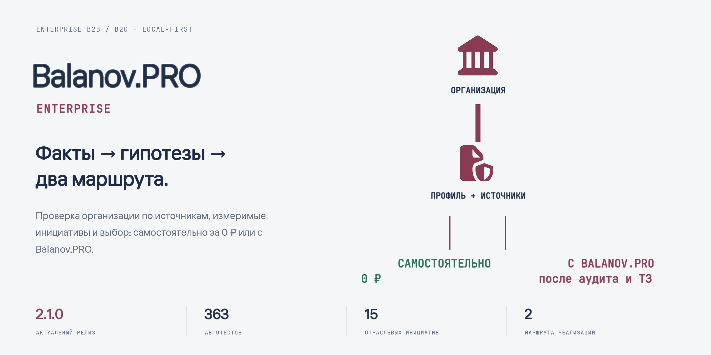
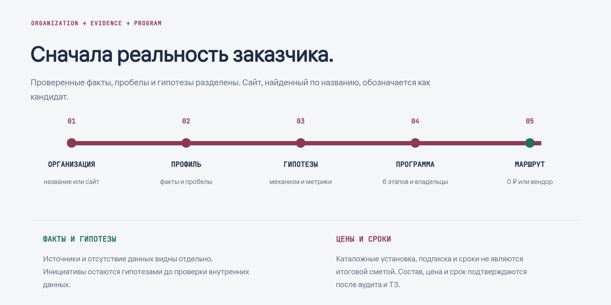

<div align="center">
  
  <p><strong>Локальный ИИ-советник для enterprise B2B и B2G: проверка организации по источникам, измеримые гипотезы и два маршрута реализации.</strong></p>
  <p><a href="#что-делает-клиент">Возможности</a> · <a href="#локальная-модель-и-границы">Локальная модель</a> · <a href="#установка">Установка</a> · <a href="https://balanov.pro/balanov-pro-enterprise/">Страница продукта</a> · <a href="https://github.com/Balanov/balanov-pro-enterprise/releases/tag/v2.1.0">Релиз 2.1.0</a></p>
</div>

Разработчик и вендор: **Баланов Антон Николаевич**. Экосистема: Balanov.PRO, BAIagent, A2OS и Paritet.

[Страница продукта](https://balanov.pro/balanov-pro-enterprise/) · [Скачать Windows x64](https://github.com/Balanov/balanov-pro-enterprise/releases/download/v2.1.0/Balanov-PRO-Enterprise-Setup-Windows-2.1.0-x64.exe)

**SHA-256:** `af60450ab33ad2a250f283ec907649ee7ed21223666d764265a12291c050ed48`

## Что делает клиент

- Принимает название компании, министерства, ведомства, госструктуры или прямой адрес сайта.
- Показывает название, доступный логотип или favicon, направления, предложения, отзывы и внешний контекст только с источниками.
- Явно отделяет проверенные факты, пробелы и гипотезы. Сайт, найденный по названию, обозначается как кандидат.
- Раскрывает каждую гипотезу: основание, механизм, метрики, владельца, необходимые данные, правовые и организационные рамки, защиту и критерии контроля.
- Предлагает самостоятельный план за **0 ₽** без оплаты услуг Balanov.PRO. Внутренние трудозатраты и инфраструктура заказчика не называются бесплатными.
- При релевантном совпадении показывает отдельно установку, абонентскую плату и базовый срок из каталога. Итоговые состав, цена и срок подтверждаются после аудита и технического задания.
- Формирует новые гипотезы в рамках цели, бюджета, срока и контура размещения, заданных пользователем.
- Работает с явно выбранными PDF, DOCX, TXT, MD, CSV и JSON; папка требует отдельного подтверждения.
- Ведёт диалог с локальным советником и экспортирует управленческий Markdown-бриф.

- Формирует портфель из **15 отраслевых инициатив** и многоэтапную программу с зависимостями, владельцами, метриками, правовыми рамками и необходимыми доступами.

<div align="center">
  
  <p><sub>Сначала реальность заказчика. Каталожные цены и сроки не являются итоговой сметой.</sub></p>
</div>

## Локальная модель и границы

Windows-клиент предпочитает `qwen3:8b`, затем `qwen3:14b` из существующей локальной Ollama. При отсутствии Ollama предусмотрена загрузка встроенной Qwen при первом анализе. Модель не входит в установщик.

Диалог, анализ и текст выбранных документов обрабатываются локально. Свежий поиск и чтение публичных сайтов требуют интернет. Веб-версия использует серверное исследование и не выдаёт себя за локальный запуск модели.

Приложение — советник, а не автономный сотрудник. Оно не гарантирует эффект, юридическое соответствие или безопасность контура и не выполняет необратимые операции в системах заказчика.

## Установка

Windows 10/11 x64. Установщик создаёт ярлыки Balanov.PRO Enterprise и не требует прав администратора при стандартной установке для пользователя.

Текущая локальная сборка **не имеет Authenticode-подписи**: Windows и SmartScreen могут показать предупреждение о неизвестном издателе. Перед распространением по крупной корпоративной сети рекомендуется подписать выпуск сертификатом организации и проверить его в своём контуре.

## Разработка

Требуются Node.js 24 и npm.

```bash
npm ci
npm run electron:dev
```

Проверки и сборки:

```bash
npm test
npm run build:enterprise
node scripts/build-desktop.mjs --enterprise
npm run dist:win:enterprise
```

Установщик появляется в `release-enterprise/`. Для живой проверки исследования и локальной Ollama:

```bash
node scripts/smoke-live.mjs "https://example.org/" organization-result
```

Живые результаты сохраняются только локально в `test-results/` и не публикуются.

## Структура

```text
src/             Enterprise-интерфейс React
electron/        Изолированный desktop-контур, исследование, файлы и Qwen
shared/          Доказательства, каталог, гипотезы, маршруты и бриф
scripts/         Сборка и проверки
tests/           Автоматические регрессионные тесты
build/           Фирменные ресурсы установщика
```

## Проверено перед выпуском 2.1.0

- **363 автотеста в 30 файлах**.
- Production desktop-сборка и реальные Windows smoke-сценарии интерфейса.
- Проверены 4 инициативы пилота, 14 основной программы и 15 максимального контура, оба маршрута и компактный Windows-экран.
- Реальный B2B-сценарий на сайте «Теремок» и B2G-сценарий на сайте Минцифры России с локальной `qwen3:8b`.
- Проверка точных цитат, идентичности разработчика, двух маршрутов и каталожных значений.

## Безопасность и лицензия

См. [SECURITY.md](SECURITY.md). Код распространяется по [AGPL-3.0-or-later](LICENSE). Qwen и сторонние зависимости сохраняют собственные лицензии.
